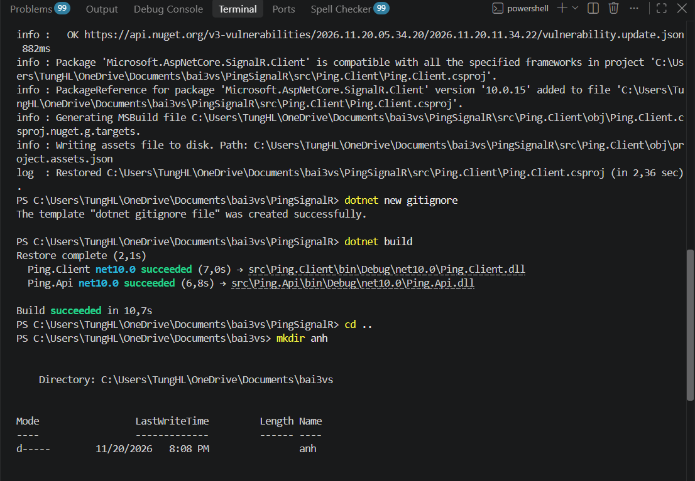

# Bài 3 — SignalR

## Bước 1: Tạo project và build

Đã tạo Ping.Api và Ping.Client. Lệnh dotnet build chạy thành công.
## Bước 2: Kiểm tra SignalR

Máy chủ trả về connectionId và các cách truyền tải SignalR.
## Bước 4: Echo

Máy khách An gọi Echo và nhận phản hồi riêng từ máy chủ.
## Bước 5: Broadcast và nhóm

An nhận thông báo nhóm và Broadcast của Bình. An không nhận Echo của Bình vì Echo chỉ gửi cho người gọi.
## Bước 6: Tự kết nối lại

Khi máy chủ ngắt đột ngột, An báo đang kết nối lại. Sau khi máy chủ chạy lại, An kết nối thành công với ConnectionId mới.
## Bước 7: Thí nghiệm lỗi

| Thí nghiệm | Hiện tượng | Giải thích |
|---|---|---|
| Máy chủ chưa chạy | Không kết nối được | Lần kết nối đầu tiên thất bại. |
| Sai `/hub/ping` | Báo 404 | Đường dẫn không khớp `/hubs/ping` trên máy chủ. |
| Sai `EchoRespone` | Vẫn chạy nhưng không có Echo | Tên thông điệp gửi và tên đăng ký nhận không khớp. |

